# Good morning: Tallgrass overnight report

*(Updated 22:15 Saturday 2026-10-24. This file is refreshed at every milestone.)*

## 2026-10-24: Tallgrass 1.0 (the V1.0 polish run, live and public)
**Releases:** [v1.0.0](https://github.com/Samizdat-Publications/tallgrass/releases/tag/v1.0.0) (16:55), [v1.0.1](https://github.com/Samizdat-Publications/tallgrass/releases/tag/v1.0.1) (19:00), [v1.0.2](https://github.com/Samizdat-Publications/tallgrass/releases/tag/v1.0.2) (21:40), [v1.0.3](https://github.com/Samizdat-Publications/tallgrass/releases/tag/v1.0.3) (22:10), [v1.0.4](https://github.com/Samizdat-Publications/tallgrass/releases/tag/v1.0.4) (22:30, live now: ravens spiral onto a kill, the ?sunhold=1 trial). **Play it:** https://tallgrass.stewartgregerson.workers.dev · **Landing page:** https://tallgrass.pages.dev · **Hub:** https://samizdat-e0x.pages.dev · **Source:** https://github.com/Samizdat-Publications/tallgrass (or `npm run dev`, then http://localhost:5199/).

**What you asked for:** as polished as it can get for V1.0 by midnight, then public on the hub. The simulation was left alone (the default world is still v10b, golden hashes unchanged); everything went into what a stranger sees first.

### What changed (all live)
1. **A first visit that never shows a blank page.** A poster of the valley and "Preparing the valley" paint with the HTML, the title card sits over it while the shaders compile, and it fades into the live valley once the herds are drawn. The three tips are full sentences and no longer cover the population panel. Phones get a calm "made for a desktop" card with a link to the landing page and a Try anyway button; browsers without WebGL2 get a plain explanation instead of a broken page.
2. **About Tallgrass** in the menu: version, a paragraph, links to the landing page and the source, and every third-party credit with its licence.
3. **Ravens that read as ravens** up close: black with a faint blue sheen, fingered wing tips, a wedge tail, a heavy bill, and they keep clear of a feeding wolf.
4. **Bison that read as bison** up close: matte chocolate coats instead of glossy rust, short upturned horns instead of cattle horns, a higher hump.
5. **The documentary camera at night** frames the herds low against the moonlit sky instead of looking down at dark grass, and leaves dog towns and raptors for daylight.
6. **Fire** spreads with a ragged burning edge instead of the simulation grid's rectangles; **hoof dust** is tan and billows instead of pink comb spokes.
7. **Slow machines** step down from High to Medium picture quality once (saved, with a note), after the opening 40 s.
8. **Wording:** distemper is no longer called plague, adding wolves to a valley that has them no longer says they "return", cougars that wander in and out no longer get "the last cougar is gone" cards, a prairie dog drop on bad ground says nothing settled.
9. **Zoom** stops at 900 m instead of shrinking the valley to a square in the haze.
10. **A full QA sweep** of the live build (both 1920x1080 and 1366x768, every menu, tool, overlay and key) found no errors and 25 rough edges; the fixes landed tonight: the challenge list scrolls (two challenges were unreachable), a tool takes the camera from the documentary director so you see your fire land, overlays rise to a map view, the graph and photo mode stop covering the animal card, New valley has its Start button always in view and hawks and eagles on by default, Esc from a title page returns to the title, and the narrator key says so.
11. **The interface gives the valley room:** the population panel is a slim strip of species counts by default (hover or click for the full panel with sparklines; your choice is remembered) and stays a strip while you follow an animal or the documentary camera films; a field-note toast waits until the camera is on the place it happened.
12. **Ravens over a kill** come down in a loose kettle instead of a tall column, and **the documentary camera at golden hour** frames lower for the long shadows.
13. **After the release, the same evening:** winter from the drone (snow feathers into a dusting at range instead of camouflage blotches, the creek lifts to the sky with a pale ice rim), pronghorn gallop with the legs gathered under the body instead of a rocking-horse leap, ravens' and raptors' left wings bend at the elbow (a mirrored-weight bug drew a folded left wing as a long blade), and the field guide only counts animals that are actually in the picture.
14. **Later still (release 1.0.1):** the land beyond the valley continues as prairie with groves instead of a square in haze; ravens on the ground fold their wings flat; packed bison near the camera no longer pass through each other (display only); spring greens up and rain reads as rain (streaks over the far ground, cooler air, wet sheen); a chapter card more than a year late is dropped. A quiet-GPU A/B shows the evening build equal or faster in every view.
15. **After 1.0.1:** a map legend with distinct predator marks (wolves crimson, cougars vermilion, coyotes amber on the map; the population strip keeps its colours), tooltips and labels on the corner icons, the Overlays button no longer looks disabled when idle, the territory fill thins near the camera, a **Pair** view in the graph (two species on their own axes, bison against wolves by default), grizzled near wolves with tawny legs, and a selection ring that reads all the way round wolves, coyotes and cougars. Liam's Roblox session from about 19:15: no GPU work after that (no benchmarks, no captures).
16. **Release 1.0.2:** golden eagles read as eagles (warm brown, golden nape, pale wing and tail marks, larger than ravens); ravens at a kill no longer pop in and out (one-frame jumps measured down from about 160 to about 5); the map legend's predators sit on their own hues; field-note toasts wait for their place to be on screen with your own camera too; the yearly eagle and hawk arrivals are Chronicle lines instead of title cards.
17. **Release 1.0.3:** following an animal, the ground shows a short sward of real grass blades instead of a smeared texture; at the wide view the animals keep their value in rain, and pronghorn and mule deer read grey-brown on snow instead of orange. GPU: about +0.5 ms on the golden views, every view under the 16.7 ms budget.
18. **Release 1.0.4 and after:** ravens spiral down onto a kill instead of dropping in a column; the `?sunhold=1` trial (below); a wolf-pack label on the territory map that would sit under the time bar is now left out (deployed 22:40, no new release).

**Look at first:** the landing page hero, then Play in a fresh browser tab (the poster, the title, the tips), then the menu > About.

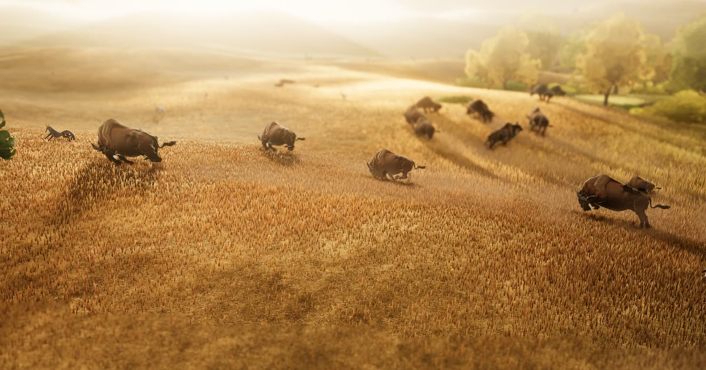
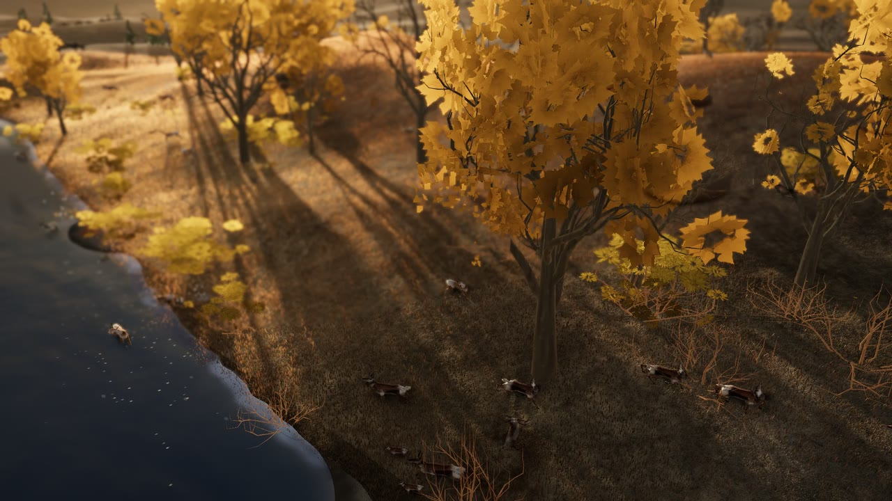
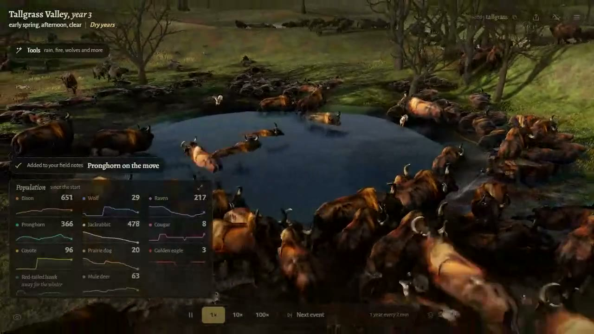
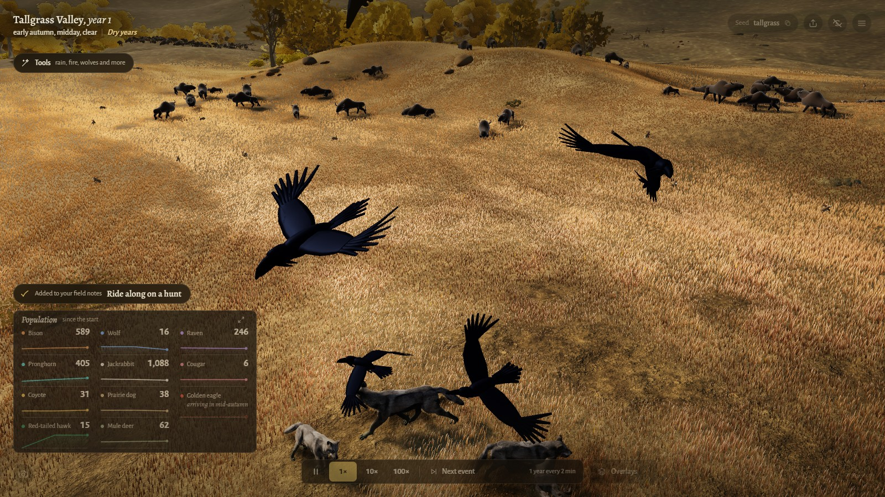
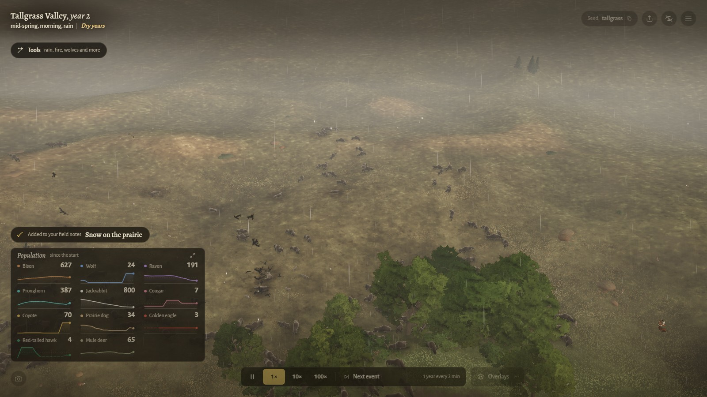
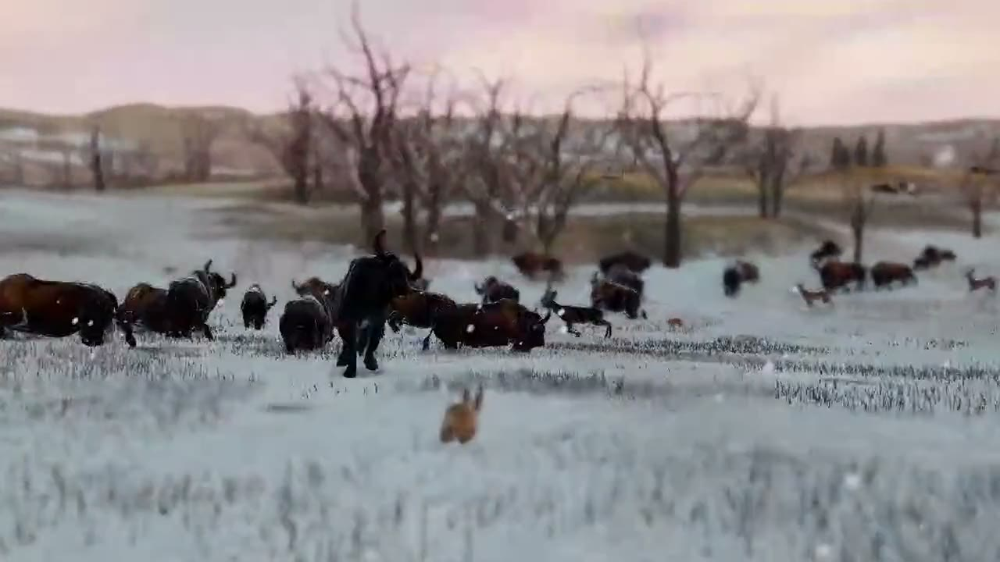

### Reviews this run
- **Blind critic, stills:** round 33 (before the polish) visual 6, readability 5, life 7, ecosystem 6, UI 7, keep watching 6; round 35 (release candidate) 6, 5, 7, 6, 6, 6. Its close-up items from round 33 (glossy bison, grey-paddle ravens) are gone from the list; it now leads with the interface covering the action (being fixed: a compact population strip) and with field-note toasts that do not match the shot.
- **Gemini video:** round 34 (108 s reel) life 3, keep watching 4, the same sliding-feet note as every video round (measured slip is under 1.4%); its one concrete item, a Chronicle repeating the same blizzard line, is fixed. The new landing hero was checked by Gemini too; its one fair point (bedded bison overlapping into a dark blob in a snow shot) dropped that shot from the cut.
- **QA sweep:** 25 issues, triaged item by item in REVIEWS.md; no console or page errors.
- **GPU:** the V1.0 build is the same or faster than the pre-V1 build in every view (A, B, B, A at 1440p); the weather changes are within noise.
- **Later rounds:** blind round 36 (6, 5, 6, 6, 6, 6) and 37 (visual 7, the rest 5 to 6); Gemini round 38 on a smooth 30 fps take: visual 7, life 2 (see the motion question below).
- Triage for everything is in REVIEWS.md (rounds 33 to 38 and the QA sweep).

### Decisions you might want to overrule
- **Ages:** an animal's card gives its age in that species' own years (a bison's life mapped onto a real bison's), while the family tree dates births in valley years, so a 10-year-old bull can be born in year 2 of a year-6 valley. Left as is; the fix is a wording choice (say "bison years", or show valley years on the card).
- **The biggest open question, motion (Gemini rounds 34 and 38):** even on a smooth 30 fps take Gemini scores "life and motion" 2 to 3, saying the animals slide while the light sweeps in time-lapse. At 1x a valley day lasts 80 s, so shadows race across the land while legs walk at real speed, and that mismatch may be most of what reads as sliding (measured foot slip is under 1.4%). Options: a slower day at 1x (light only, the sim calendar unchanged), or hold the sun steadier while the documentary camera films. Your call; the default is unchanged. To try the second option, add `?sunhold=1` to the game URL and press C: the sun then holds through each documentary shot and catches up at the cut (a Gemini take with it scored life 3 against 2 without, inside its noise, so judge by eye).
- **Licences:** the wolf, pronghorn and mule deer models are CC BY-NC (non-commercial), as ruled before. Fine for a free public game; resolve before anything commercial.
- **100x** still reaches about 45 to 60x on this machine (the time bar says so honestly). A real speed-up has to keep the golden hashes bit-identical; the profile is flat (no line over 3%), so it is a project of its own.

### Next 5
1. Motion, the open question above: a slower-looking day at 1x (light only) or a steadier sun while the documentary camera films, then a Gemini video round to see whether "sliding" goes away.
2. A pale soft rectangle near the bottom of the territory-map still while a blizzard is building (scratch capture, review set shot 11, late autumn evening): not the pack label (it stays with the label hidden), most likely the blizzard ground haze or a weather sprite. Find it and fix it.
3. 100x speed: it reaches about 45 to 60x here. A real speed-up must keep the golden hashes bit-identical, so it is a project of its own.
4. Ages: card in species years, family tree in valley years (pick one wording).
5. The sim items every critic repeats (flat long-run charts, mule deer and prairie dogs low, ravens swinging, bison calving outside spring): a planned sim pass with the stability suite, not a release-night change.

## 2026-10-09 to 10: the 24-hour day run (the plan is DAY-PLAN.md)
**Play it:** https://tallgrass.stewartgregerson.workers.dev (or `npm run dev`, then http://localhost:5199/). Last deploy: 19:29 Saturday (D14, ravens), live check clean. The default world is still v10b. **This is the checkpoint to test: D14.** The run stopped at 01:15 Sunday with the weekly quota at 65%.

**What you asked for:** take stock, then spend 24 hours on what gives the most: visuals and the remaining features. The ecosystem already passed every gate, so the day went to how the valley looks up close and how the animals move.

### Saturday afternoon and evening (since you got back at 13:30): seven deploys, D8 to D14
- **Faster start (D8):** cold ready 19 to 24 s on the live page (was 28 to 70 s); a black-first-frame bug found and fixed on the way.
- **Herds notice predators (D9):** walking and bedded grazers turn their heads to a passing wolf, bison face one inside 25 m.
- **Camera and trees (D10, D11):** no more checkerboard trunks near the lens; the chase camera keeps a followed wolf in the picture.
- **Look (D12, D13):** matte bison with a dark head and a pale tan cape, dark herds at night with a thin moon rim, calm moonlit ponds, a legible playback bar; from the overview pronghorn read as tan antelope instead of white flecks, coyotes darker and smaller than wolves.
- **Ravens (D14):** they stand beside a carcass instead of sinking into it, and the idle ones thin out from the overview so the sky no longer reads as flies.
- **Waterhole crowding: tried three ways, not adopted.** Staggered thirst alone does not spread the herd; a milder walk-off costs mule deer 14%; the best try (walk back off the bank only over open ground, "v12") cut the near-water share from 0.54 to 0.47 but over 1,200 years mule deer fell 15% and recovery after shocks was weaker than v10b's (review/stability/v12-f219729/RESULT.md). v10b stays. To see v12 anyway: https://tallgrass.stewartgregerson.workers.dev/?p=shoreSpread:1,shoreOpen:2

### What changed in the day run (all live)
1. **Real animal models.** Bison, wolf, pronghorn, mule deer, coyote and cougar are authored meshes now, driven by our own animation rig (foot lock, leg IK, gaits, poses), instead of the clay shapes. Measured paw slip is under 1.4% in every gait (it was 3 to 11% when the models first went in). `?a3=0` shows the old animals.
2. **Animals that live.** They breathe, shift weight, look around and sniff, flick ears and swish tails; grazers lift their heads and turn toward a wolf that passes; predators keep worrying at a carcass; the coyote's mousing leap has a crouch, an arc and a pounce; animals wade in the creek instead of walking on top of it.
3. **Golden hour like the concept.** Low sun is warm and readable instead of purple and muddy, the glare near the sun is gone, the rippled-dune hills are smooth.
4. **Real trees.** Branching cottonwoods and willows with leaf clusters, bare winter skeletons and clean bark, and cheaper than the old trees in groves. `?trees3=0` shows the old ones.
5. **Ground, water and night.** Photo-scanned ground detail up close; darker ponds and creek with reflections and muddy, trampled shores; moonlit rims that separate the herds at night.
6. **Speed.** A performance pass took the heaviest view from 17.5 to 13.7 ms at 1440p, putting every view under the 16.7 ms budget. A clean bench of the final build (D7) on a quiet machine Saturday 08:30 confirms it: every view under 16.7 ms at 1440p, the heaviest low golden 14.5 ms and creek midday 14.5 ms (review/wip/day/gpubench_final_d7.json).
7. **Smaller fixes:** snow by landform, a quiet selection ring that fades, small blood stains instead of a red disc, no dotted "screen door" on animals at mid range, the follow camera keeps a chasing wolf and its prey in frame, faded panels stay legible, field-note cards read as notebook entries.

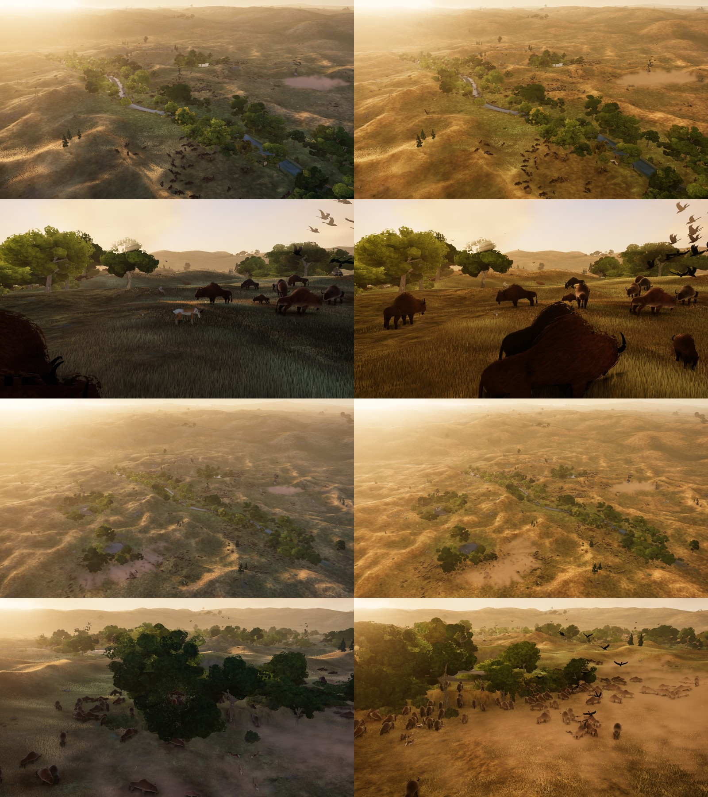
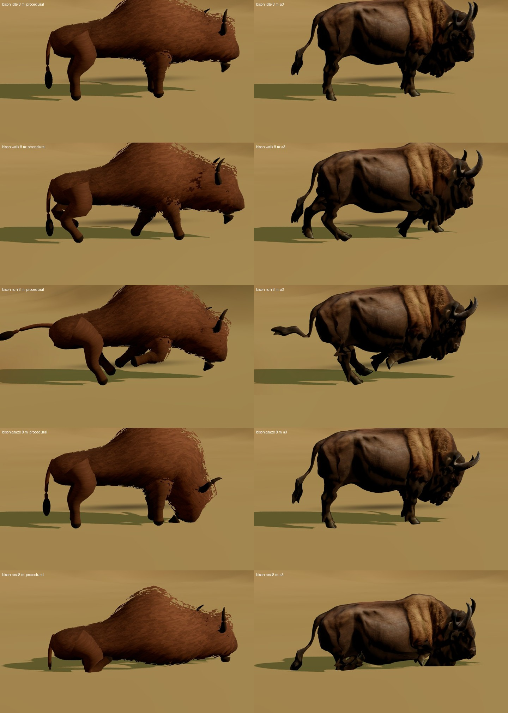
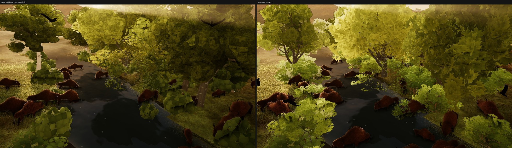
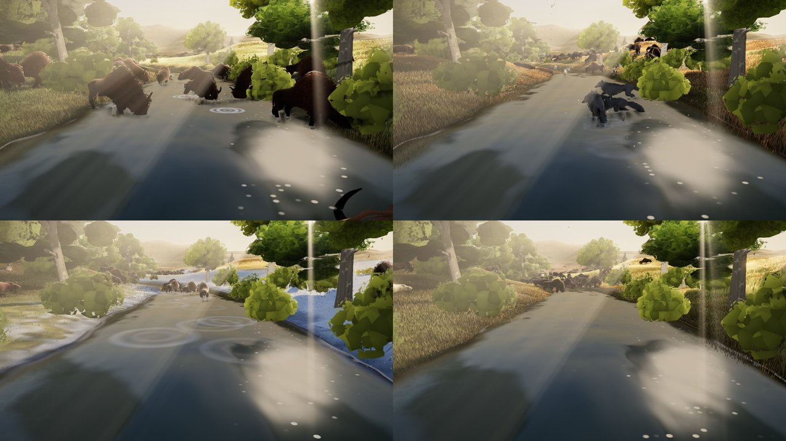
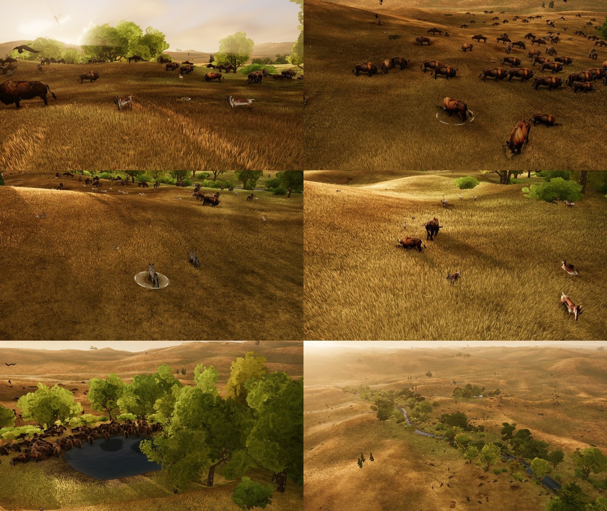

### Reviews (judge the trend; single rounds swing 2 to 3 points)
- **Blind critic, stills:** round 25 (Friday 21:30) visual 6, readability 4, life 4, ecosystem 5, keep watching 5; round 28 (Saturday 05:10) visual 7, readability 5, life 6, ecosystem 6, UI 7, keep watching 6; round 32 (Saturday 15:55, on D11) visual 6, readability 4, life 6, ecosystem 6, UI 7, keep watching 6. Its top item, telling species apart at the overview distance, is improved in D13 (clearly for pronghorn, mildly for coyotes and kills; a kill inside a crowded herd is still hard to find); its bison and night items are fixed in D12. A 100-year zoom of the v10b runs (review/stability/v10b-1f3f658/zoom_600_700.png) backs its point that the populations hold steady with noise rather than swinging in predator-prey cycles.
- **Gemini video, now at 8 frames a second** (it used to see 1 frame a second, which hides every stride): life and motion 3 (baseline Friday 15:49), 1 (round 26, frozen animals), 3 (round 27, after the idle layer), 2 (round 29, on D6: deaths that snap into a rigid pose, fixed in D7), 2 (round 30, on D8: herds that ignore a passing wolf, fixed in D9; UI 8, readability 7), 3 (round 31, on D9: ecosystem believability up from 2 to 6, keep watching 4; its blocky trunk and lost chase shot are fixed in D10 and D11).
- Triage for every round is in REVIEWS.md.

### Ecology this run (nothing adopted; v10b stays; the Saturday evening waterhole tries are above)
- **Bison herd bands (v11 first try): dropped.** Seven variants, with and without a new "bands move on to fresh grass" lever; bison fell 16 to 35% in every one.
- **The waterhole mob (round 25 and 28's top complaint): fix built, not adopted.** A new behaviour (bison drink in waves and walk back off the bank) cut the bison crowding the water from 53% to 42% and passed every standard gate over 20 worlds x 1,200 years, but mule deer fell from 71 to 43. That would undo v10b's mule deer recovery, so it stays an off setting (`?p=shoreSpread:1` to try it). `review/stability/v11-feaa081/RESULT.md`.
- **Stronger climate (climate2 0.4): not adopted.** A little more breath, prairie dogs -25%.

### Decisions you might want to overrule
- **Licences:** following your ruling, some models are non-commercial (wolf, pronghorn, mule deer: CC BY-NC). All sources are in CREDITS.md. Clear them before any commercial release.
- **v11 not adopted** on the mule deer cost although the gates passed (above).
- **Trees and animals on by default** (`?trees3=0`, `?a3=0` restore the old ones).
- The **Chronicle hides completely** when the UI idles; the population panel stays faintly visible.

### Blocked or cut
- **Your C: drive was full** (333 MB free of 925 GB) at 08:00 Saturday. I cleared about 22 GB of this project's own old scratch copies (old batch checkouts and review videos; results are kept in the repo); it now has 23 GB free. The rest of the drive is outside this project and worth a look.
- **Start time (fixed in D8, not all the way):** the live page used to take 28 to 70 s to become ready, nearly all of it shader compiles. D8 compiles them all at once before the first frame: the live page is now ready in 19 to 24 s from a cold browser (2 runs at 14:05, a busy machine; the local build measured 15 to 45 s against 84 to 158 s with the old path, interleaved). Still above the 15 s goal. A bug found on the way (a negative first-frame time step turned the weather values into NaN and the first frame black) is fixed.
- Wide-view readability (telling species apart at mid range) and the noisy-looking population charts are still open.
- Your CPU ruling (16:00, then 85% from 18:00) cost about two hours of builder speed in the evening; no work was lost.

### API spend
- Gemini: 6 video critiques at 8 fps (no paid calls after 15:20 Saturday) (logged at about $0.05 each; 8 fps sends more frames, so likely $0.10 to $0.30 in all).
- Sketchfab: free downloads only, no paid generation; Meshy: 0 credits used (746 left).
- Everything is logged in ASSETS.md.

### Next 5
1. The waterhole ring from a different angle: where bison graze between drinks (grass near water stays greenest in the dry years every review shot uses), not how they leave the bank (three tries this run, RESULT.md above).
2. 100x runs at about 47x on this machine (471 of 1,000 ticks a second, measured Saturday 08:50 with one builder running; 1x and 10x hold): profile the sim worker and the snapshot path, or relabel the button by what it reaches.
3. Kills inside a crowded herd are still hard to find from the overview (D13 helped in open ground): a marker or a camera hint tied to the kill toast.
4. A clean GPU re-bench of D14 on an idle machine (the ravens A/B ran with batches going; read as +0.1 to 0.2 ms).
5. A Gemini round on a quiet machine with a hand-picked reel (a hunt, a herd crossing, a death), so the motion score reflects the best moments rather than random ones.

### Deploy log (all live checks clean)
D1 19:45 golden look, snow · D2 21:35 wading, alert heads, ground detail, performance · D3 01:10 real animals, real trees, land · D4 02:45 idle life · D5 04:05 planted feet, leap · D6 06:45 night and water, round 28 fixes · D7 08:23 deaths and takedowns at any speed, tumbling birds, animals on ice · D8 14:03 faster start (all shaders compiled at once), first-frame NaN fix · D9 15:13 walking and bedded grazers turn their heads to a passing predator, bison face a wolf inside 25 m · D10 15:28 no more checkerboard tree trunks near the camera · D11 15:43 the chase camera keeps a followed wolf in the picture · D12 16:26 matte bison coat with a pale tan cape and a dark head, dark animals at night with a thin moon rim, calm moonlit ponds, a legible idle playback bar · D13 17:10 species read apart from the overview: pronghorn are tan with a white rump instead of white flecks, coyotes darker and smaller than wolves, kill sites readable from further out · D14 19:29 ravens stand beside a carcass instead of sinking into it; from the overview the idle ravens thin out and glide, so the sky no longer reads as a swarm of flies (GPU cost not yet measured: you were gaming).

## 2026-10-09 night: "The long breath" (v10)
**Play it:** https://tallgrass.stewartgregerson.workers.dev (or `npm run dev`, then http://localhost:5199/). **v10b is now the default world** (v10 adopted at 10:30, then its refinement v10b at 13:00, each after its acceptance and shocks passed; live, see the last line of this section).

**What you asked for:** fix the wolves and bison (my call), an ecosystem that lasts without petering out, and a fast-forward that looks like a valley breathing. The plan I worked from is `NIGHT-PLAN.md`; every call and number is in `DECISIONS.md` (2026-10-09).

### What was wrong (measured on the v9 runs, not guessed)
- **Evolution ran away.** Over 1,400 years bison came to bear 2.4 calves a birth and lost their herding instinct (0.92 to 0.24); wolves got 39% faster and 29% bigger and grew from 46 to 77. That drift is where the 1:7 wolf ratio and the late mule deer collapse came from. A fix (bounded evolution) had been built on 10-06 and never switched on.
- **Wolves could not follow the herd**: the open prairie refilled the pronghorn to the same number every spring whatever happened, so wolves always had food while the bison crashed.
- **The herd overshot and starved about every 8 years**, too fast to read as anything but noise.

### What changed
1. **Climate regimes (new):** wet and dry runs of decades, with a megadrought of 3 to 6 years now and then. They move how much grass the land carries, summer dry spells, lightning fires, cottonwood seedlings and the pronghorn the prairie sends back. In wet runs the valley carries about 60% more standing grass than in dry runs, and dry runs see twice the lightning fires (acceptance data: 63% and 2.2x).
2. **Bounded evolution switched on**: bison keep single calves and their herding; traits stay believable for centuries.
3. **Fewer, bigger wolf packs** (dens 280 m apart, 130 m territories).
4. **You can see it:** dry runs bleach the valley to straw and haze, wet runs deepen the greens, a megadrought goes to pale bone; the big graph (G) has a climate band behind the populations; the header says Wet years, Dry years or Megadrought; the chronicle and the narrator mark the turns.
5. **Fast-forward made for watching decades:** from about 30x the light holds a steady morning and the seasons are damped, so the decades breathe instead of the days and seasons strobing; moving herds and packs leave long-exposure trails on the land; each species shows in its own colour from the drone views. The sim itself is 1.4x faster with identical results, so 100x is closer to real 100x on an idle machine.
6. **Documentary camera v3:** it films running animals alongside at rider height, keeps both hunter and prey in frame (or drops the shot), and only shows a card or a narrator line once the camera is on that event; cuts now dip briefly through a soft dark and the exposure adapts over about a second, so a dark close shot no longer slams into a bright hillside.
7. **Rare sightings (your idle idea):** Menu, Rare sightings. Thirteen moments unlock with real time watched at 1x (10 minutes, 1, 4 and 12 hours): a great stampede, a cougar out on open ground, a pale bison, a comet over the valley, a great aurora. Each is kept with a photo, the valley year and a line of chronicle.
8. **Smaller fixes from tonight's reviews:** migrating hawks and eagles read "away for the winter" instead of extinct, the population cards keep their places, one season vocabulary everywhere, a softer selection marker, ground detail and stubble under close follow shots, lying bison no longer stretched.

### The numbers
- **v10 acceptance** (20 worlds x 1,200 valley years, `review/stability/v10-97eef97/RESULT.md`): every gate passes. Bison persist in 20/20; every species is present at least 90% of the time in at least 19 of 20 worlds; wolf CV 0.23; wolves follow the bison at 0.50 a year behind (gate 0.4); raven CV 0.38. Means: bison 484, wolves 37 (1:13; v9 drifted to 1:7), pronghorn 543, mule deer 19, coyotes 76.
- **The breath:** the dominant swing of bison, wolves and ravens is now **45 years** (v9: 8 to 10), and bison follow the climate index at 0.52. In wet runs the valley carries 60% more standing grass than in dry runs.
- **Shocks** (12 worlds x 500 years): bison and wolves recover in every world after a 70% cull, a drought and a wolf wipeout (bison in a median 14, 19 and 27 years).
- **Generations:** with single calves the bison clock is slower, so 1,200 years is about 530 bison generations (pronghorn pass 1,000). I kept the same 1,200-year span rather than running 2,300 years for 1,000 bison generations.
- **v10b, adopted at 13:00** (v10 plus pronghorn capped at twins, a dearer sprint for wolves, ravens and coyotes starting near their long-run numbers): its acceptance (20 x 1,200 years) passes every gate with **mule deer at 70 (v10: 19)**, bison 549, wolves 33 (**1:17**), pronghorn 368, wolves following the bison at 0.54, pronghorn starvation 39%; its shocks recover bison, wolves and pronghorn in every world. `review/stability/v10b-1f3f658/RESULT.md`.

### What to look at first
1. Set **100x**, press **G**, and leave it for two minutes: green and tan bands roll under the population lines as the valley greens and browns.
2. Stay at 100x with the graph closed: the drone shots show each species in colour and the herds' trails across the land.
3. Leave it alone at **1x** for a while (the documentary camera takes over after 25 s): running animals filmed alongside; then open **Menu, Rare sightings** to see what is still locked.
4. The default world is the long breath now (Menu, Scenarios, The long breath is the same world).

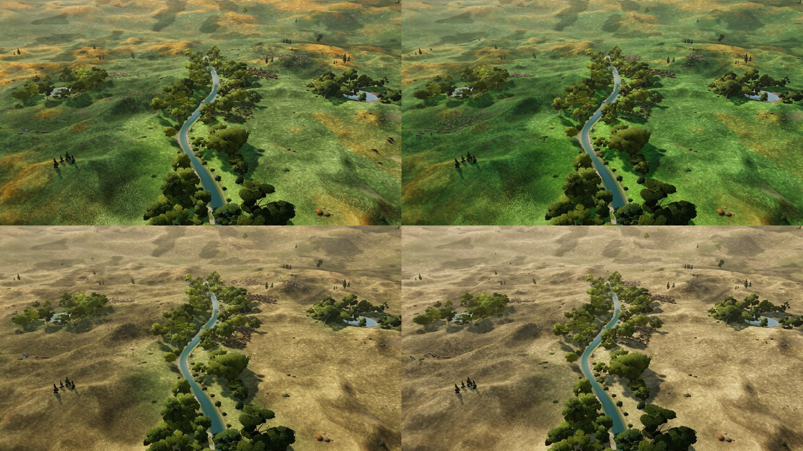
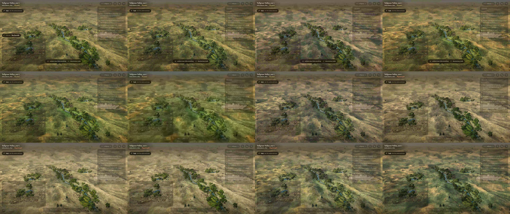
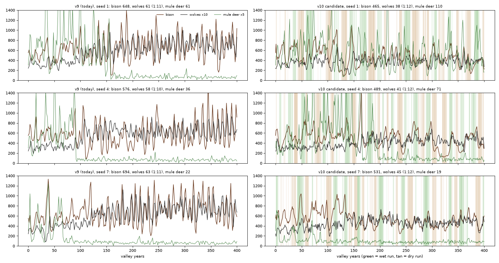
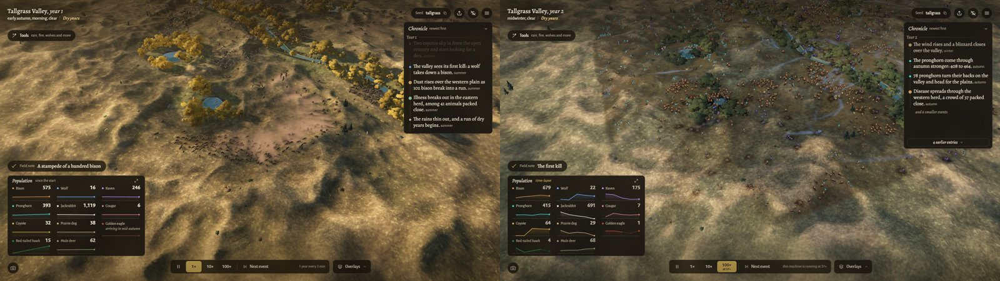
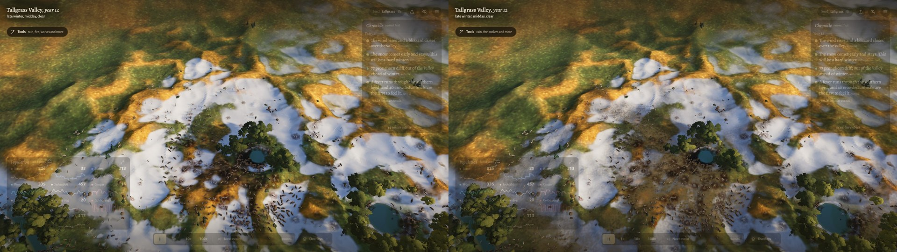
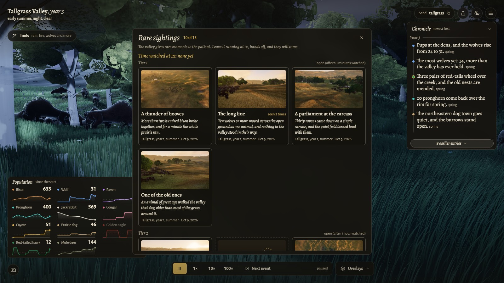

### Reviews tonight
- Round 21 (blind critic, charts only): ecosystem believability 6, up from 5 in every round since 15.
- Round 22 (blind critic, game stills): 6/5/6/7/7/6; ecosystem 7, UI 7. Its top complaint was the close follow view (fixed in part tonight).
- Round 23 (Gemini video): life and motion 4, up from 2 in rounds 18 and 19; ecosystem 7, UI 7. Its top complaint, species unreadable at 100x, is fixed.
- Round 24 (Gemini video of the deployed v10): readability 8 (was 4), UI 8, visual 6, motion 3, ecosystem 5 (single Gemini rounds swing 2 to 3 points). It caught a strobe at 100x (lightning flashes and the season swing), fixed and deployed at 12:03. Its other items (herds not reacting to a passing wolf, sliding gaits, kills that read as a bump, wolves on the river surface) are next-cycle work, listed in REVIEWS.md.

### Decisions you might want to overrule
- **Adopted v10 tonight** (the four switches above), with the acceptance over 1,200 valley years instead of 1,000 bison generations (see Numbers).
- **Fewer wolves on purpose:** 4 or 5 packs (measured), about 37 wolves. If you liked seeing more wolves, set wolfDenMinDist back toward 200.
- **The fast-forward look** (steady morning light and damped seasons from about 30x, long-exposure trails at 10x and 100x, species colours at speed) is my call for "breathing". `?lapse=0` and `?trails=0`, or Settings, Long exposure at speed, turn parts off.
- **Rare sightings rules:** patience counts only real time at 1x with the tab visible and nobody touching it; tiers at 10 minutes, 1, 4 and 12 hours.
- **Herd bands stay off** (they cost 12 to 15% of the bison); **the new snow look stays on its branch** (r-snow) until its frame cost is measured on an idle machine.

### Bigger valley?
You allowed it; I did not do it tonight. A read-only study is in `VALLEY-SIZE.md`: it is possible but large (dozens of places assume 512 m and 32 x 32 grids, and grass per square metre is fixed, so a bigger valley would hold 2.25x to 4x the animals unless productivity is rescaled). Herd bands (built tonight, off) may get most of the "less carpet" benefit sooner.

### Blocked or cut
- Bison herd bands work visually (separate groups with grass between them) but cost 12 to 15% of the bison in every variant tried, so they stay off.
- Builder worktree isolation failed under the CPU load late in the night; I created worktrees by hand instead (no effect on the work).
- Captures and playtests timed out for a while because the dev server was watching 37 builder worktrees; fixed (vite ignores .claude/).
- The making-of page (claude.ai artifact) was not republished tonight; tonight's images are in `journey/` (INDEX.md). To refresh it: `.venv/Scripts/python tools/journey_page.py --artifact --out scratch/making-of/index.html`, then republish.

### API spend tonight
ElevenLabs: 5 narrator lines, 486 characters (about $0.10). Gemini: 1 video critique (about $0.05). Everything is in `ASSETS.md`.

### Next 5
1. Watch v10b at 1x and 100x and tell me what you think of the fewer wolves and the climate swings; then the next sim step is bison herd bands without the bison cost.
2. Re-measure 100x on an idle machine (tonight three CPU batches held the browser to 10x to 40x) and consider a 300x or "skip a decade" control now that the sim is 1.4x faster.
3. Herd bands without the bison cost (bigger bands, or more forage for banded bison), then a screen with v10b: the real fix for the "bison carpet".
4. Close-up pass two: lying bison legs (dark slabs), pack wolves overlapping at rest, raven flocking at carcasses, exposure jumps between director cuts.
5. Snow: re-bench r-snow on an idle machine and merge if it fits the frame budget; wet ground in rain.

Last deploy: 13:04 Friday (main with v10b adopted and every merge from tonight); build, golden hashes, playtest and live check clean (no console or page errors).

## 2026-10-08 and 09: the design calls (live)
- **Ecology, checkpoint v9:** ravens now breed to the carrion supply instead of sitting at a fixed ceiling, mule deer have more woody-cover habitat, and new valleys start with 550 bison instead of 800 so the opening is not a brown carpet. Passed the 20-world acceptance (every species held in all 20) and the shock tests.
- **Seeing the animals:** the follow camera frames the animal you follow; predators are darker and cooler, pronghorn and deer show bright rumps; far herds separate into bodies; from the top view each animal gets a small colour glyph so herds and packs are countable.
- **Motion:** wolves, coyotes and cougars flex their spines at a gallop, splashes and wake rings when animals cross water, birds keep flapping in time-lapse, snow fades in instead of popping, no animals floating on ponds.
- **World:** water reads as water (depth colour, reflections, flow, broken banks); a blizzard is now a whiteout.
- **Interface:** one Tools button opens a drawer, panels fade when you stop moving the mouse, the big graph docks at the bottom with clean labels, the speed button shows the real rate, territories are outlines with a light hatch, the status line matches the weather.
- **Still open for your planner:** population swings look like noise rather than long boom-and-crash cycles; this is a design question for the sim, not a tuning one. Also mule deer over centuries, herd density, and video reviewers still scoring motion low.

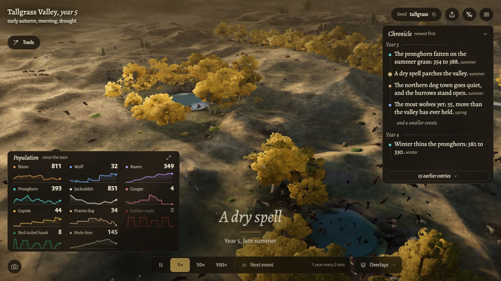
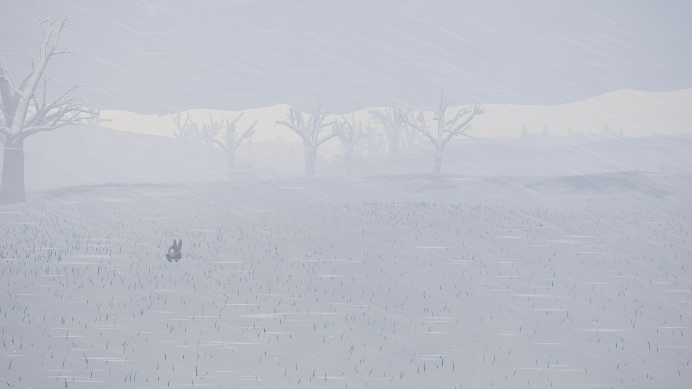

## 2026-10-08 overnight: v8b is the default world (live)
Snow depth (drifts, bare windswept ground) and living trees (they seed, grow, burn to snags and fall) are now part of every valley, together with a fix for the one weakness every long run showed this week: prairie dog towns that died out stayed empty for decades. New colonies now arrive from the open prairie every 8 years instead of 20. The 20-world acceptance passed with every species present in all 20 worlds, and bison recovered from every shock test.

Also overnight: a fresh review round (stills and video). It caught a real bug (a black disc in tree canopies from yesterday's camera change), now fixed and live. The rest of its list is for your planner: too many bison crowding the wide views (wider spacing alone barely changes it), small animals hard to see, mule deer and raven long-run dynamics, and water that looks like a road.

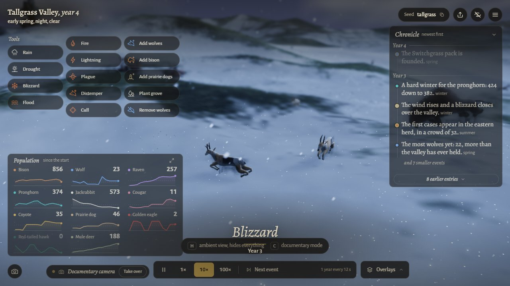

## 2026-10-07 afternoon and evening: review round and fixes (all live)
A fresh blind critic (stills) and a Gemini video review looked at the v7c world (`review/round-15`, `review/round-16-video`). Fixed and deployed:
- Territory overlay: every pack's range now shows as a lit, softly bordered colour patch with its name and den (it was nearly invisible by day and a flat blob at night).
- Chronicle: no more word-for-word repeats; arrivals in the same year fold into one line.
- Documentary camera: cuts to the subject of each field note and headline event (a close pronghorn, the carcass the ravens are on, the prairie dog town).
- Camera no longer hugs tree crowns; foliage dissolves near the lens. Night herds are readable.
- Real beaver model that swims, marsh edges on beaver ponds, browner floodwater.
- Animals plant their feet better and lean with the slope.
- Calmer population panel at 10x and 100x, honest sparkline scales, a labelled graph legend, and a tool rail that no longer reshuffles.
- Wide views: snow follows the land, creek banks show, less haze in the middle distance, no hard map edge from above.

Left for your planner (design calls): about 1,000 bison crowding the wide views (the video reviewer liked the scale, the still critic did not), long-run cycles that read as jitter, mule deer settling near 10, and the slow first decades.

**Next checkpoint (v8):** snow depth plus living trees passed a 32-world test (prairie dogs did even better than now); its 20-world acceptance then missed by one world on prairie dogs (17 of 20, the gate is 18), so it is not adopted and v7c stays. Prairie dog towns are the weak point in every long run this week; that is the first thing for your planner. Dust storms, grasshoppers and spring floods failed (they wipe out prairie dog towns) and stay off. The 'wolves recover in only 75% of worlds' item turned out to be a measuring quirk: wolves came back in all 20.

## v7c is the default world (adopted 2026-10-07 13:20, live)
Golden eagles (winter visitors), red-tailed hawks, six cougars, sixty mule deer, storm cells with lightning fires and herd spacing are now part of every new valley. It passed the full 20-world acceptance (every species held; prairie dogs in 18 of 20 worlds, at the gate) and all three shock tests (bison recovered in every world after a 70% cull, a drought and a wolf wipeout). The challenges still play as they were designed (those six settings are pinned off for them).

Your idle-events idea is saved in `MAYBE-WANTS.md` for the next planning session.

## v2 integration (session 2026-10-06 afternoon; live redeployed 14:57, live check clean)
Everything Track S built in the cloud (S0 to S18) is now merged into main and live at https://tallgrass.stewartgregerson.workers.dev.

**How to play:** open the link, or run `npm run dev` and open the local address. The left rail has the god tools; the menu (top right) has New valley, Challenges and the Field guide.

**What's new since the beta**
- Play: an Add prairie dogs tool starts a town where you click, so "The town that came back" can now be won. Four new challenges: meso (coyotes run wild after the wolves are trapped out), town, storm (five dry-lightning seasons) and cats (cougars and mule deer in a closed valley).
- UI: on short screens with a challenge card, the tool rail now wraps into a second column instead of running under the population panel.
- Ecology (all in the sim, merged): canid distemper and mange, open-prairie migrants, coyotes, jackrabbit and prairie dog fields with plague, storm cells and lightning fires, raptors, mule deer and working cougars, evolution v2, herd spacing, winter snow depth, dust storms, grasshoppers and spring floods, dynamic trees, beavers and moving water, lineage, share codes and replay, decade chronicle lines.
- Checked: npm test (golden hashes 340c052c, 714770ae, 617dea6c), typecheck and build pass; a GPU playtest (2 min at 1x, 5 min at 10x, every new god tool, all four new challenges) and the live site show no console or page errors.

**On by default (checkpoint v6b):** coyotes, jackrabbits, prairie dog towns with plague, open-prairie migrants, distemper and mange.

**Still off by default, and why**
- Raptors, storm cells, cougars, mule deer and herd spacing (the v7a candidate): its acceptance failed on prairie dogs (see below).
- Snow depth, dust storms, grasshoppers, spring floods, dynamic trees, beavers, evolution v2: all of them now draw (see below), but none has had its own 32-world screen and acceptance yet. Each stays off until it passes. You can try any of them with a URL like `?p=snowDepth:1` or `?p=beavers:1,beaver.initial:6`.

**v7a (raptors, storms, cougars, mule deer, herd spacing) was not adopted.** The full 20-world acceptance passed bison (19 of 20), the other core species, wolf cycles (CV 0.26) and ravens (CV 0.18), but prairie dogs were present at least 90% of the time in only 11 of 20 worlds (v6b: 20 of 20), and one world lost its bison. v6b stays the default; details in `review/stability/v7a-c9c3f5a/RESULT.md`. You can overrule this in DECISIONS.md.

**Rendered since the merge (still off by default in the sim):** per-cell snow depth (drifts in hollows, bare windswept ground) when snowDepth is on; living trees that seed, grow, burn to snags and fall when dynamicTrees is on; dust storms and grasshopper swarms; beaver ponds, dams and lodges (the beavers themselves are a stand-in for now); planted groves and floodwater for the grove and flood god tools and spring floods. Last redeploy about 22:00, playtest and live check clean.

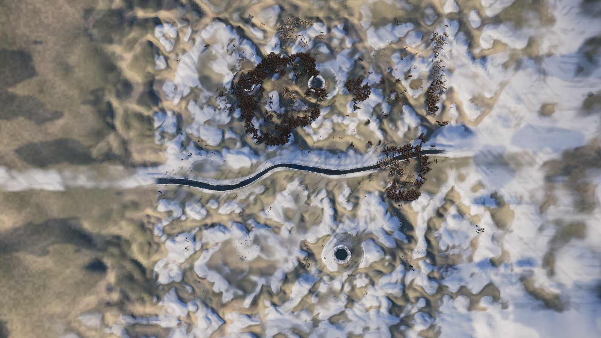
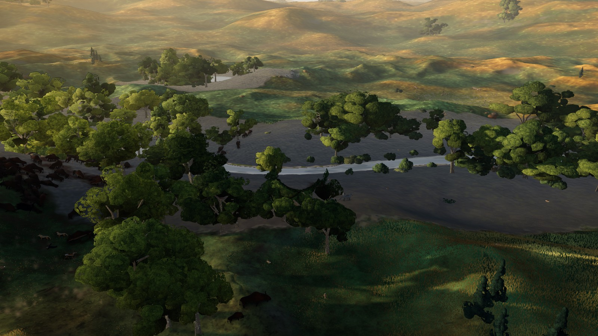

**More tools on the rail:** lightning (click a spot), blizzard, flood, distemper (wolves and coyotes) and plant grove (click a spot) join the original nine; the rail groups them into columns that fit any screen. Why v7a failed is now known: the eagles and hawks eat too many prairie dogs (without them, towns hold in 31 of 32 worlds). A new setting halves, then quarters, their taste for prairie dogs; at a quarter the towns hold as well as with no raptors and the eagles still come every winter. That candidate (v7b) then missed the 20-world acceptance by a single world: prairie dogs held in 17 of 20 (the gate is 18; v7a managed 11), everything else passed. v6b stays the default. A gentler setting (v7c, raptor taste for prairie dogs at a tenth) then passed the full acceptance: every species held, prairie dogs in 18 of 20 worlds, right at the gate. Its shock suite (cull, drought, wolf wipeout) was started at 23:17 and finishes after this session; if bison recover, the next session makes v7c the default (raptors, storm cells, cougars, mule deer and herd spacing on).

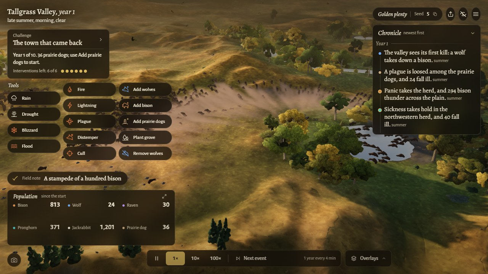

**v6b shock suite (finished):** bison persisted in 20 of 20 worlds and recovered in all of them after a 70% cull, a drought and a wolf wipeout (median recovery 44, 13 and 41 years). v6b stays the default.

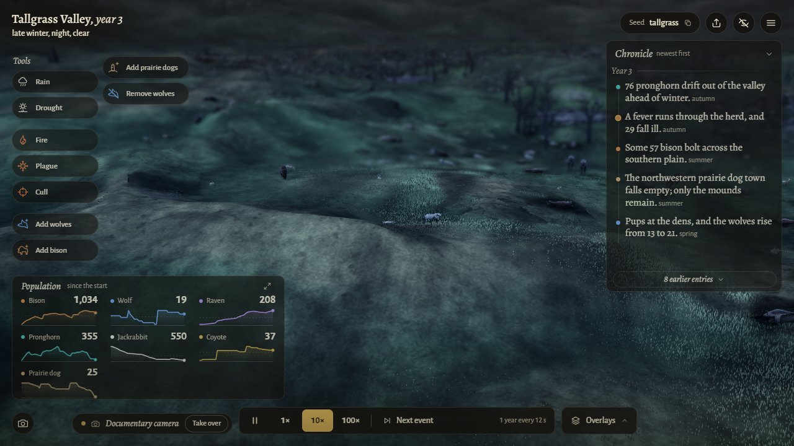
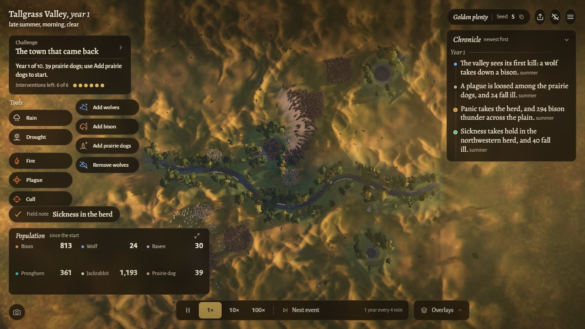

**Next 5:**
1. Read the v7c shock suite (running, ends about 01:35); if bison recover in at least 80% of worlds after each shock, adopt v7c (NEXT-SESSION.md has the exact steps).
2. If prairie dogs still miss, screen cougars, mule deer and herd spacing one at a time over long runs.
3. A real beaver model with a swim pose (the render uses a rabbit stand-in), and a marsh tint for shallow flooded ground.
4. 32-world screens for snowDepth 1 and dynamicTrees 1 (now that both draw), toward the next checkpoint.
5. Keep the making-of page current: `python tools/journey_page.py --artifact --out scratch/making-of/index.html`, then republish with the new journey images (version 13 now).

## v2 beta progress (session wrap-up 2026-10-05 ~10:20; live redeployed 10:15, live check clean)
Since the alpha (below), all merged, live and verified (npm test, build, foot-slip rig, review stills with no errors):

**Visual**
- Trees v2: lobed crowns and dense creek groves, with willow thickets, autumn gold, junipers and burned snags.
- Night sky: stars and the Milky Way, moon phases that drive the moonlight, meteors, a winter aurora and fireflies.
- Lens: a photo mode (P), gentle depth of field in the documentary camera's close shots, and film grain in cinematic mode (C).
- The camera no longer clips through trees and glides smoothly in pans.

**Animals**
- Near-range fur detail: a shaggy bison cape and hump with horns, wolf and coyote ruffs, a fur sheen.
- Coyotes: mousing leaps, dusk howls and mange.
- Golden eagles and red-tailed hawks: soaring, stooping and perching.
- Mule deer: seasonal antlers and a stotting bound.
- Cougars: a low stalk, a freeze, then the rush.
- A behaviour library: bison wallows, tree rubs, snow digging, summer sparring, bellows and calf play; wolf howl choruses, pup play and scent marking; pronghorn rump flares; raven rolls; raptors preening.

**Play**
- Family tree (select an animal, then press T): a pedigree three generations up and two down, plus a wolf pack's line of alpha pairs.

**Ecology**
- v6 is the default world.
- v6b (small prey and coyotes on) passed its 32-world screen.
- Its 1,000-generation acceptance kept every species alive in 20 of 20 worlds. Prairie dogs touch near zero during plague 1.1% of the time, so the run marks them FAIL; whether to adopt v6b is Track S's call.
- The v6b shock suite was still running at wrap-up; results land in `review/stability/v6b-b51d880-shocks300`.
- Raptors, deer and cougars, storms and small prey stay off by default until they pass. Try them through New valley.

**Quota:** weekly at about 82% when this session stopped (your 85% ruling). The cloud Track S session runs separately.

**Next 5:**
1. Track S adopts v6b, then screens the storms and the raptor, deer and cougar configs (v6c and v7).
2. R10: dust storms, grasshoppers and floods (after S12).
3. R13: god tools v2 and new challenges (after S17).
4. R16: beavers and moving water.
5. R17: performance presets. The low golden view sits at 15.5 of 16.7 ms, and a dense herd within 54 m costs 2 ms.

**Making-of page:** version 12 at https://claude.ai/artifact/7jPHUFvbzTv6AUz5UCA3Mu.

## v2 alpha (M1, deployed 2026-10-05 00:55; redeployed 02:40 with the v6 ecology and coyote render)
**Play it:** https://tallgrass.stewartgregerson.workers.dev. The live check passed at 00:56: no errors, 60 fps at 1600x900. The title card shows on first load; click **Watch**. Everything below the v2 sections is the v1 report.

**Look at first:**
1. The title card, then Watch. The golden-hour valley now has warm sun-side haze, a creek that mirrors the sky, golden cured uplands, drifting cloud shadows and god rays.
2. Menu, then **Field guide**: photograph behaviours. Menu, then **Settings**: separate volumes for ambience, music and narrator. The **Share** icon (top right) copies a link that replays your valley exactly.
3. Follow a wolf (click it, then F). Feet now lock to the ground and legs reach it on slopes. Kills show a lunge, a hold and tug, pack mates at different contact points, feeders in slots and ravens hopping in.
4. Fast-forward to 10x and 100x. Animals bound with a slow long stride and kick up dust, and the light goes soft so the shadows stop strobing.
5. Wait for dawn after a calm night: mist pools in the creek valley. Winter brings snow that buries the grass. Night keeps the herds readable.
6. Music: five ElevenLabs cues that crossfade with the tension of the hunt. **Please listen**: I could only check loudness and loop seams, not taste.

**Built but off by default** (each turns on only after 32-world screens and a 1,000-generation acceptance):
- open prairie with migration in and out, vagrant ravens, distemper and mange
- jackrabbits, prairie dog towns and plague; coyotes
- storm cells with lightning fires
- You can try them now through New valley. Track S flips them on as each config passes.

**Stability, from actual runs:**
- **v6E acceptance** (`review/stability/v6E-3bb97a5`, 20 worlds x 1,000 bison generations, about 1,340 years):
  - every species alive in 20 of 20, never near zero
  - wolf CV 0.24 (v1: about 0.1), raven CV 0.15
  - wolves follow bison by 1 year (correlation 0.69)
- **v6E shock suite** (cull 70%, drought, wolf wipeout over 300 years): every species persists in all 20 worlds, and bison recover every time. After a wipeout, wolves come back in 75% of worlds.
- **v6G** (spring-only births) failed its acceptance: bison lasted in only 17 of 20 worlds. So **E is v6**.
- **v6 is now the default world** (live since 02:40): open prairie, vagrant ravens, distemper and mange, prey-scaled wolves. New golden hashes: 79f7ab0f, ef09535f, 032d866a. The sealed valley is a scenario now.
- **Coyotes** (with mousing leaps and dusk howls), raptors, small prey and storms are built but stay off by default until their own screens pass. Try them through New valley.

**Reviews:**
- Round 13 blind critic: visual 7, life and motion 6.
- Round 14 Gemini video: **life and motion 4** (v1: 1 to 3), visual 7, UI 8. Its fixes are in: time-lapse gait, night animals, shadow strobe, rain depth, contact shadows.
- The Gemini concept judge sits at 4/10 whatever changes, so I use its difference list, not its score.

**Decisions you might overrule** (DECISIONS.md):
- I kept ACES tone mapping.
- I stayed on Three.js rather than an engine port (your quality-over-shareability ruling is logged; revisit with a side-by-side).
- Tree bark is now grey-brown (it was crushed to black by ambient occlusion).
- Copper bluestem fades out in early winter.

**Blocked or deferred:**
- Camera collision with trees.
- A family tree panel (waits for its UI).
- Tree groves and canopy volume (R11).
- A grey band at the cloud base in storm drone views.

**v2 spend:**
- Gemini: about 20 concept-judge calls, 1 video critique and about 32 audio checks, about $0.40.
- ElevenLabs: 6 music generations, 22 sound effects and 14 narrator lines, about 4.3k credits of the pay-as-you-go balance.

**Next 5:**
1. Coyote model and mange coat (in progress).
2. Merge the v6 default flip and redeploy.
3. Tree groves (R11).
4. Animal fidelity (R7).
5. Camera collision.

Making-of page: https://claude.ai/artifact/7jPHUFvbzTv6AUz5UCA3Mu (version 10, now with the v2 images).

## How to run it (one step)
Open **https://tallgrass.stewartgregerson.workers.dev** in Chrome or Edge. Click once anywhere to turn on sound. (The live build is redeployed after each verified milestone; the time of the last deploy is in the line below.)

Last deploy: 11:19 Sunday (commit 86eb206: everything below, including a takedown that reads as a fight, the green riparian ribbon along the creek and ponds, the round 9 fixes (rain in the map view, frozen-pond rims, smaller chapter titles, traits in plain words, quieter graph labels, a coral territory) and the final quick round: natural grey wolves, slimmer predators and brown bison from above, bison dark at dusk, idle head bobs and look-arounds, prey that struggles under a kill, wolf territories as tinted ranges, side panels that dim after 20 s idle, softer snow edges, smooth rocks, ponds without a white glare disc; and the rounds before it: smoother animal motion, curled resting wolves, species readable from above, carcasses on the slope, gliding ravens, water that reads at distance and in rain, winter snowpack and bare trees, visible rain, the chronicle's season lines, softer territories, the Hungry wolves scenario, the 2x valley calendar and the narrator), verified live at 11:19: no errors at 60 fps (1280x720); the default world reads "1 year every 2 min" and challenges keep "1 year every 4 min".

Locally: `npm run dev`, then http://localhost:5199/.
- `?seed=anything` picks a world, `?scenario=yellowstone` picks a scenario, `?challenge=herd` starts a challenge. The menu (top right) does all three.
- Performance on this machine's RTX 5070 Ti Laptop GPU, measured after renderer round 7 (06:30 Sunday, GPU timers, median ms per frame at 1440p): wide golden 10.0, low golden 15.8, herd 10.3, top 9.6, winter 9.2, night 11.4. The final quick round (animals, UI, water, renderer) adds about 0.5 ms per frame at 1440p and the riparian ribbon about 0.35 ms more (0.8 ms in the low grass view), in a paired GPU test with the two builds swapped between runs: an A/A test showed this bench can favour one side by up to 1 ms on its own, so a single A/B run misleads. The live checks show 57 to 60 fps at 1280x720. The low grass view has the least headroom. On bigger or high-DPI screens the game lowers its render resolution a little if it has to, to hold 60 fps.
- Keys: Space pause, 1/2/3 speed, **N next event** (the camera flies to it), **C cinematic documentary mode**, **P photo** (saves a clean PNG of the frame), G big graph, E evolution chart, L log scale, F follow the selected animal, **H ambient view** (hides all UI; any key or click brings it back), **V narrator on/off**, M mute, Esc back out. Click an animal to inspect it and read its life story. Left-drag orbits, right-drag pans, wheel zooms.

## What it is
**Tallgrass**: a living tallgrass prairie seen like a drone nature documentary. Grass greens and cures with the seasons; bison graze it and pronghorn browse forbs and shrubs; wolf packs hold named territories, bud new packs and fight over borders; ravens follow every kill; carcasses feed the soil. Every animal carries heritable traits (speed, size, sight, boldness, herding, coat, litter) that evolve. The sim runs in a Web Worker, deterministic from the seed. The renderer is Three.js (WebGL2) with about a million wind-blown grass blades, procedurally animated instanced animals, a golden-hour sky with a slow day cycle, seasons, snow, fire with smoke and regrowth. The UI is a "documentary broadcast" overlay: location slate, chronicle, chapter cards, population and evolution graphs, inspector with each animal's life story, god tools, map overlays. Ambient sound and SFX by ElevenLabs.

New since Saturday evening (overnight into Sunday):
- **A slower, truer calendar:** a valley year is now 2 minutes at 1x, so a bison lives about 6.7 valley-years and the herds boom and bust over a decade instead of a few years. Proven over 1,000 generations (see Stability).
- **A documentary narrator:** a calm voice speaks a line when something big happens (a drought, a stampede, a new pack, a fire, the first kill), only while the documentary camera or cinematic mode is filming at 1x or 10x, at most once every 40 seconds. **V** or the menu switch turns it off. In cinematic mode the line also shows as a caption.
- **Field notes** (menu): a naturalist's notebook of 18 moments you witness, from the first kill and a 100-bison stampede to riding along on a hunt, reading an animal's whole life story, or catching a kill on the documentary camera. Notes tick off with a quiet toast and are remembered between visits.
- **Fast-forward is faster:** 100x had been running at about a quarter of that; the sim now gets more of each frame.
- **Animals you can read from the drone:** wolves wear a natural grizzled grey with a faint neutral glint at distance, bison stay a dark brown at dusk (neither black stains nor rust), pronghorn read tan, and from straight above each species keeps its own proportions (wolves narrower than bison). Bodies bound and pitch with the slope more strongly at distance, so movement reads as effort even when legs are a few pixels tall. The selection ring is a crisp thin ring. Carcasses show a pale belly and a fresh-kill stain.
- **Motion that reads:** animals now move along a smoothed path (uneven snapshot timing made running animals surge and stall, so their legs lurched; the measured speed jitter fell from 44% to 25%), resting wolves lie curled instead of reading as pale sticks end-on, carcasses settle onto the slope, and ravens alternate flapping bursts with glides and soaring.
- **Documentary camera:** it now cuts to a subject across the valley instead of flying the camera through the trees, and near moves ease in and out.
- **A chronicle that keeps up:** besides events, it now writes a line when a season leaves a mark ("A hard winter for the bison: 636 down to 569", "Pups at the dens: 47 wolves to 55", ravens gathering, records), about one or two a year. Wolf territories are soft tinted ranges instead of neon rings, and the narrator's captions sit on a soft shadow so they read on bright grass.
- **UI:** the chronicle is newest first everywhere, with a season tag on each entry and an "N earlier entries" pager. Chapter cards never contradict the header: once the valley leaves the season a card names, it trims to the year, even while on screen. **H** (or the eye button by the menu) gives an ambient view with no interface for a second monitor.
- **A landing page draft** (you mentioned the journey could become one): https://claude.ai/artifact/JHgLkaPPUGvWmeZU5FJ3YM (private to you). Film stills from the current build, what you can do in the game, a chart drawn from a real 1,000-generation run, and the controls; source in `landing/`.
- **Winters and weather that read:** on the short calendar snow storms were rare, so winters looked like autumn. Deep winter now carries a patchy snowpack, trees stay bare until spring (a leaf-curve bug had them greening in late winter), rain brings overcast light and streaks (which fade out in the straight-down map view), and nights keep their relief instead of a flat teal.
- **Water that reads as water:** depth and a visible bed, a creek current that scrolls downstream, wet banks, reflections of the banks and trees, and ponds that freeze from the shore in winter.
- **Final quick round (deployed between 09:51 and 11:19, with fixes from review rounds 9 and 10):** grazers bob their heads between bites, look up and around now and then, and flick their tails; prey fights a wolf's takedown for about a second (bucking, rearing, head tosses, legs scrabbling) before it rolls over; side panels dim after 20 s idle (`?dim=0` turns it off); ponds facing the sun no longer blow out to a white disc; snowpack edges are ragged and flecked with grass; rocks are smooth ground-tinted boulders; frozen ponds have a soft drift of snow against the shore instead of a glowing white ring at night; chapter titles are a little smaller; the inspector shows traits in plain words against the founders ("speed +5%", "coat darker"); the big graph's low axis numbers are quieter so rows don't read as one column; the rose wolf territory is now a clearer coral.
- **A green riparian ribbon** along the creek and around the ponds, as in your concept image: 11 to 37 m wide, widening and pinching along the channel, greener than the uplands through the autumn cure, muted in winter, dulled by drought and grazing. Pond and creek rims are a lighter, broken mud lip instead of a dark ring.
- **Snow bug fixed:** after a fast-forward on a slow frame rate, snow could linger into early summer. Weather now tracks the calendar at any frame rate.

Earlier, Saturday (since 09:00):
- **Challenges** (menu, top): five tuned challenges, each a named world, a time limit, an intervention budget and a goal. From easiest: *The wolves come home*, *Island of plenty*, *Save the herd*, *Pull it back*, *The dry years*. Each was played headless on the current sim both hands-off (it fails) and by a simple scripted player (it can be won within the budget); `tools/challenge_suite.py` re-checks all five in one command; re-run on this morning's final code (10:57 Sunday): all five still fail hands-off and are won by the scripted player. Details in `DECISIONS.md` (11:35 and 17:20).
- **Map overlays** (button right of the time controls): vegetation, landscape of fear, wolf territories with pack names and sizes, and a speed-gene heatmap.
- **Life story** in the inspector, with an "In memoriam" card when the animal dies. **Named worlds** in the menu (seeds with remarkable histories). **Photo mode** (P).
- **Cougars** in the "Cougar country" scenario: ambush hunters that wait in cover by the water.
- Renderer round 3: fire leaves a charred scar with smoke and greens back up; autumn dusk no longer wine-red; the square world edge is gone; late summer is honey gold rather than orange.
- Round 4 (Saturday afternoon and evening):
  - **Animals:**
    - Feet plant on the ground (measured slip fell from 47 to 67% of body speed to 8 to 12%).
    - Running animals visibly bound at drone distance, and turns are smooth with banking.
    - A kill shows a lunge and the prey stumbling over.
    - Stampedes kick up dust.
    - Ravens cast no shadows in flight.
    - Bison are chocolate, and pronghorn tan and white.
  - **World:**
    - Distant hills read as combed grass with green draws instead of sand.
    - Trees and rocks are rebuilt.
    - Water is darker, with reflections.
    - Snow follows the slopes.
  - **UI:**
    - The big graph shows one row per species.
    - The chronicle groups by year.
    - Chapter cards sit in the lower third.
    - Founding animals have a backstory.
  - **Camera:** it drifts slowly during fast-forward.

## What to look at first
1. Open the link, **click once** (that turns the sound on), and leave it alone: the camera opens on the biggest herd, after 20 seconds without input the side panels dim, after 25 the **documentary camera** takes over, cutting between hunts, kills, herds and vistas, and the **narrator** speaks when something big happens. Any mouse or key input, or Take over, gives you the camera back.
2. Press **C** for the full cinematic version (interface hidden, letterbox, narrator lines as captions), or **H** for the ambient view on a second monitor.
3. Menu, Challenges, **The wolves come home**: bring wolves back to a valley that lost them. It's the gentle one.
4. Overlays, **Wolf territories**, then 10x: watch packs form, bud and fall apart.
5. Press **G**, then 100x: decades of booms and crashes, now on the slower calendar. **E** for evolution.

## Screenshots (the 10:59 build, captured at 11:01 in `review/morning/final/`; the 11:19 deploy only changes the kill animation; earlier sets in `review/morning/`)
- `1_golden_herd.png`: the creek valley from the drone in late-summer light, with the new green ribbon along the banks and herds grazing by the cottonwoods.
- `2_golden_low.png`: ground level against a low sun, bison passing close and a carcass in the grass (no interface, H).
- `3_dusk_valley.png`: the whole valley at dusk, the creek's tree line and the pond.
- `4_winter_dawn.png`: winter dawn, patchy snowpack, bare cottonwoods and a herd strung along the creek, whose current keeps it open.
- `5_ui_golden.png`: the documentary interface with the chronicle's season lines.
- `6_ui_territories.png`: wolf territories as tinted ranges with named packs, and a chapter card.
- From the 09:10 set in `review/morning/sunday2/`: `7_follow_a_wolf_hunt.png` (following a founder wolf pup, with its traits, life story and a Field note), `8_field_notes.png`, `9_chart_60_years.png` (60 valley-years in 4 worlds), `10_chart_shocks.png` (the 300-year shock suite).
- Every image made tonight, in order, is in `journey/` (see `journey/INDEX.md`), as you asked. **Browse them as a page with a slideshow: https://claude.ai/artifact/7jPHUFvbzTv6AUz5UCA3Mu** (private to you; republished as new images are added). Locally: open `journey/index.html`.

## Stability: what is proven and what isn't (honest)
The default sim is now **checkpoint v5 on a 2x valley calendar** (since about 06:10 Sunday). Same animals and rules as v5, but a valley year is 1,200 ticks (2 minutes at 1x) instead of 2,400, so a bison lives about 6.7 valley-years instead of 3.3. Every critic since round 3 said the population swings were too fast for "years"; this is the fix I kept deferring, done properly. Challenges keep the classic calendar they were tuned on.

- **2x calendar acceptance** (`review/stability/cal2-2a5caf9/`): 20 worlds, each run until its bison passed **1,000 generations (1,220 to 1,402 valley-years)**. **Bison, wolves, ravens and pronghorn each survived in 19 of 20.** The lost world is seed 11: its wolves, kept at about 57 by pronghorn and small game, grind the bison out by year 40, and the rest collapses by year 115. Every criterion passes except the ravens' "not a flat line" floor (CV 0.05 against 0.05; the nest-site cap keeps them flat on both calendars).
- **What it buys, measured:** bison cycle about every 10 years (v5: 5), recover from a crash in about 8 years instead of 5.5, and swing less year to year (8% instead of 15%). Births run 0.42 per bison per year, close to real herds (v5: 0.85). Pronghorn do better than on v5: 19 of 20 instead of 18, never near zero, peaks 2.7x their mean instead of 3.4x. The cost is one world lost on three species. Chart: `journey/20261004-042209_chart_calendar-cycles.png` (60 years in 4 worlds, old calendar on top).
- **2x calendar shocks over 300 years** (`review/stability/cal2-2a5caf9-shocks300/stability_overview.png`; 20 worlds per shock, 600 valley-years, shock at 40%; my first run was cut at 3 hours by my own timeout, so seeds 15 to 20 were re-run and merged, see `metrics_merged.md`):
  - **70% cull:** every species persists in 19 of 20 worlds (seed 11 is lost before the shock) and 100% of the rest return to their pre-shock range.
  - **Severe drought:** bison, wolves and ravens persist in 17 of 20 (v5: 17, 16, 18), pronghorn in 18 (v5: 17); about 90% of survivors return to range (v5: 80 to 85%).
  - **Wolf wipeout, then reintroduction 90 years later:** wolves re-establish and persist in 19 of 20; long after, wolves sit at a median 1.03x and bison 1.21x their pre-shock levels (v5: 1.07x and 1.26x). The strict "back inside the pre-shock range and holding" metric is lower than on v5 (wolves 58% vs 95%, bison 68% vs 90%), partly because wolf and bison numbers are steadier on this calendar, so that range is narrower. One honest regression: pronghorn persist in 17 of 20 through this test against v5's 19, losing two worlds to the boom and crash around the predator-free decades.
- **Below: checkpoint v5 on the classic calendar,** which is still what the challenges run on.

- **v5 acceptance** (`review/stability/v5P-4875c69/`): 20 seeds, each run until the bison passed **1,000 generations (720 to 750 sim-years)**. **Bison, wolves and ravens survived in 20 of 20 worlds** and pass every criterion. **Pronghorn survived in 18 of 20 (90%)**, above the brief's 80% bar (v4: 75%). One criterion still flags pronghorn: a 2.5-year stretch near zero in one world, against a 2-year limit.
- **What changed from v4 to v5, and why:** the round-3 critic was right that v4's dynamics were bottom-up. Bison bore about one calf per animal per year, so the herd boomed and then starved (47 to 65% of bison deaths were starvation), and wolves barely moved. v5 changes four things:
  - Slower breeding and longer lives for both grazers.
  - Wolves spread their hunting by prey abundance, so a crashed species gets a refuge.
  - Founding cows are staggered, so the first calves don't all arrive in one pulse.
  - Lean small game, so wolves can't coast through a prey crash.
  
  At 40 years, starvation falls to 25% of bison deaths, predation rises to 37%, and year-to-year swings drop from 21% to 13%. Details and every rejected variant (about 20 screens of 32 worlds each) are in `DECISIONS.md`.
- **v5 shocks** (20 seeds x 120 years; `review/stability/v5P-4875c69-shocks/stability_overview.png`):
  - Every species persists in 90 to 100% of worlds through a 70% cull, a two-summer drought, and a wolf wipeout followed by reintroduction.
  - Pronghorn recover in 90 to 95% of worlds after a cull or drought.
  - Reintroduced wolves re-establish in 20 of 20 worlds (v4: 17 of 20).
  - The strict "bison back inside their pre-shock range" metric fails (30 to 65%). The chart shows why: the herds don't fall short, they **overshoot and settle higher** (about 450 before, about 1,000 after). The bison are still evolving bigger and faster through their first century, so a shock at year 48 lands mid-way through that climb.
- **The fair version: v5 shocks after evolution settles** (20 seeds x 300 years, shock at year 105 to 120; `review/stability/v5-shocks300/stability_overview.png`):
  - **70% cull:** every species passes, and **100% of worlds return to their pre-shock range** (bison in a median 24 years).
  - **Two-summer drought:** every species passes (80 to 85% of worlds recover; bison in a median 10 years).
  - **Wolf wipeout, then reintroduction 45 years later:** bison recover in 90% of worlds, pronghorn in 100%, ravens in 100%, and the reintroduced wolves re-establish in 95%. The tool still flags wolves and pronghorn on this one, but both flags are artifacts of the test design: the 45 deliberately wolf-free years count as wolves being "near zero", and the predator-free pronghorn boom trips the max-over-mean limit.
- **Predators control the herd (measured):** `review/stability/cascade/trophic_cascade.png`. With no predators the herd climbs to 2,500 to 3,000 on grazed-down grass; when 12 wolves arrive, it settles far lower and the grass recovers. The Yellowstone trophic cascade, emergent, not scripted.
- **v4, for comparison** (`review/stability/v4-5df7663*`): 1,000 generations, bison, wolves and ravens 20/20, pronghorn 15/20. Shocks: the cull passed for every species; the drought passed except pronghorn recovery; the wolf wipeout failed strict recovery.
- **What I tried next and did not ship (v6, Saturday evening):** about 20 more screens chasing the critics' "wolves should rise and fall a few years behind their prey". Prey-scaled wolf capacity does exactly that, lifting wolf-prey correlation from 0.29 to 0.58 at a one-year lag. Adding litter caps and individual herd protection stops the evolutionary drift and keeps herding alive. At 40 and 100 years it looked like a clear win (100 years: bison 32, wolves 31, ravens 32, pronghorn 28 of 32). But the 1,000-generation acceptance lost pronghorn in **every** finished world, between years 117 and 390: wolves that follow the pronghorn booms make each crash deeper. In this model a faster predator response trades directly against prey persistence, so **v5 stays the default**. The mechanisms are in the code, off by default, with every result in `DECISIONS.md` (18:10 to 20:35).
- **A spring birth pulse** (calves only in spring) collapsed everything on the classic calendar, because bison lived only about 3.3 valley-years. On the 2x calendar, with a birth cooldown shorter than a year, bison now survive it in 26 of 32 worlds (starvation falls to 30% of their deaths), but pronghorn, living about 3.75 valley-years, collapse in 28 of 32. So a real birth season is within reach for bison; pronghorn need a longer life first. Slow climate cycles also cost persistence.
- Cougars (opt-in "Cougar country"): under v5 they starved within 2 to 16 years in all 32 worlds (about 0.2 kills of their own per cougar-year; the valley also holds only about four cougar ranges). Retuned at 22:40 with surer ambushes, a leaner metabolism, and a pair of dispersers wandering in when the valley empties of cats. Cougars are now present 85% of the time over 40 years (13 of 16 worlds at year 40), and the other species are unaffected.

## Reviews so far
| Round | Source | Visual | Readability | Life | Ecosystem | UI | Keep watching |
|---|---|---|---|---|---|---|---|
| 1 (03:20) | blind critic, stills + charts | 5 | 3 | 5 | 2 | 6 | 3 |
| 2 (06:20) | Gemini, 99 s video | 5 | 8 | 2 | 4 | 9 | 3 |
| 3 (12:00) | blind critic, stills + 650-year charts | 6 | 4 | 5 | 4 | 7 | 5 |
| 3 (12:00) | Gemini, 108 s video | 4 | 7 | 2 | 4 | 8 | 3 |
| 4 (18:30) | blind critic, stills + v5 charts | 6 | 4 | 5 | 5 | 6 | 5 |
| 4 (18:30) | Gemini, 108 s video | 4 | 8 | 1 | 6 | 9 | 3 |
| 5 (23:10) | blind critic, stills + v5 charts | 6 | 4 | 5 | 5 | 7 | 5 |
| 5 (23:10) | Gemini, video | 5 | 8 | 3 | 6 | 9 | 5 |
| 6 (01:40) | blind critic, stills + v5 charts | 7 | 5 | 7 | 4 | 7 | 6 |
| 6 (01:40) | Gemini, video | 4 | 6 | 2 | 7 | 9 | 5 |
| 7 (07:25) | blind critic, stills + 2x-calendar charts | 7 | 6 | 6 | 4 | 7 | 5 |
| 7 (07:51) | Gemini, video | 5 | 7 | 2 | 4 | 8 | 3 |
| 8 (09:05) | blind critic, stills + 2x-calendar charts | 7 | 5 | 6 | 4 | 6 | 5 |
| 8 (09:10) | Gemini, video | 5 | 6 | 2 | 4 | 8 | 3 |
| 9 (10:19) | blind critic, stills of the 09:51 build | 7 | 5 | 6 | 5 | 7 | 6 |
| 10 (10:57) | Gemini, video before the ribbon and takedown | 7 | 6 | 3 | 8 | 9 | 5 |
| 11 (11:24) | Gemini, video of the live 11:19 build | 6 | 7 | 2 | 5 | 8 | 3 |
| 12 (11:35) | blind critic, stills of the live 11:19 build | 7 | 5 | 6 | 5 | 7 | 6 |

Every issue and its triage is in `REVIEWS.md`.
- Round 4's verdict: animals were illegible and looked motionless at drone distance. In the drone shots a wolf is about 20 px tall, so planted feet can't read. The animal work since then targets exactly that, with whole-body motion scaled to camera distance, larger minimum sizes and a kill lunge.
- Rounds 5 and 6: the stills critic's visual, life and keep-watching scores rose (visual 6 to 7, life 5 to 7). Its top complaint, three rounds running, is that population swings are too fast for "years": a bison lives about 3.3 valley-years, so a crash heals in about 5 years. That was the calendar trade-off; the 2x calendar adopted at 06:25 is the fix (see Stability). Gemini's top complaint is gait and weight in wide shots. A frame-by-frame check of its clip found a 70 to 100 m wide shot where legs are 2 to 3 px tall, so the fix is distance cues (body bob, slope pitch), not foot IK.
- Round 6 also found a real bug: deep snow in early summer after fast-forward at a low frame rate. Fixed (e82a67b).
- Round 7 (after the calendar, narrator, Field notes, renderer, water and dust rounds): readability up to 6. Praised: golden-hour and dusk lighting ("wallpaper-grade"), wolves that pop, the follow panel, the territory overlay, and shock tests that "tell a real trophic story". Its top complaint is still the predators: wolves and ravens sit on near-flat lines (the research is under Next 5 things). Fixed since: winter snowpack and leafless winter trees, visible rain, night that reads as land, distant water that reads as water, a richer chronicle, readable species from above.
- Round 8 (on the 09:01 build): scores held (stills 7, 5, 6, 4, 6, 5; Gemini 5, 6, 2, 4, 8, 3). Both critics still lead with the same two things this build can't fix tonight: predators that don't move (the stills critic) and close-up animation that reads as sliding (Gemini, even after the motion smoothing). A last quick round from it is now live: natural grey wolves, species proportions from above, softer snow edges, smooth rocks, no glare discs on ponds, clearer territories, and side panels that dim when you're not touching them.
- Round 9 (on the 09:51 build with the final quick round): ecosystem, UI and keep-watching each up a point (7, 5, 6, 5, 7, 6). Its top two are unchanged (flat wolves and ravens, evolution that stops by year 300); new complaints are muddy winter and drought colour, herds as one carpet, and rain streaks in the map view (fixed at 10:23). Its four charts were stale copies from round 8, my mistake, so its chart-legend complaints were already fixed.
- Round 10 (Gemini, video of the final build before the riparian ribbon): its best scores yet (7, 6, 3, 8, 9, 5 against round 8's 5, 6, 2, 4, 8, 3); it calls the fast-forward view "genuinely mesmerizing" and the UI and territory overlay excellent. Close-up animation is still its top complaint (sliding, a kill without struggle, metronomic ravens), even after tonight's motion rounds, so the 0.25 s struggle and the gliding ravens didn't read on video. The struggle is now about 1.2 s (deployed 11:19, checked in a kill rig, not yet on video).
- Round 11 (Gemini, the live 11:19 build, 27 minutes later): 6, 7, 2, 5, 8, 3. The build differs only by the riparian ribbon and the longer takedown, and Gemini called the same territory overlay "brilliant" in round 10 and "visually abrasive" in round 11, so single Gemini rounds swing by 2 to 3 points on their own. Its consistent message across all rounds: close-range animation (sliding feet, and now wolves that stand still beside the struggling prey) is the weakest part. That is the first item for the next session.
- Round 12 (stills critic, the live 11:19 build): the same scores as round 9, so the stills scores have plateaued here; the next gains are in the predator dynamics and close-range animation it keeps naming. It also read the 1,400-year chart's medians dropping at the very end as a late collapse: that was a chart artifact (one dead world's zeros dominating the median once the others finished), fixed at 11:38 and the charts regenerated.

## Decisions you might want to overrule
- **Stack:** TypeScript + Three.js instead of Godot (ADR-001 in `DECISIONS.md`): one language for sim, harness and renderer, headless GPU capture, and the URL build.
- **Time scale:** a year is now 2 minutes at 1x (seasons 30 s), down from 4. Biology runs per tick and is unchanged, so 1,000 generations still fit in a few hours of compute while a bison lives about 6.7 valley-years. If you'd rather keep the slower seasons of Saturday's build, set `calendarScale: 1` in `src/sim/params.ts` (or open the game with `?p=calendarScale:1`). The seasons now turn twice as fast as before; the day stays 80 s.
- **The world opens in late summer** (golden, like your concept); early summer is green.
- **Challenges keep the classic calendar** (a year is 4 minutes there): they were tuned and validated on it, and on the 2x calendar three of the five stopped behaving as tuned. Retuning them for the new calendar is a morning's work if you want one calendar everywhere.
- **The narrator is on by default** but speaks only in documentary or cinematic mode, at 1x or 10x, at most once every 40 seconds. V or the menu switch turns it off for good (remembered in your browser).
- **Hungry wolves is opt-in, not the default:** its wolves are far more alive, but its pronghorn die out within a few centuries in all 20 acceptance worlds (bison, wolves and ravens hold in 19 of 20).
- **The landing page is a private draft,** not deployed beside the game. Deploy it only if you like it.
- **Challenges** are fixed and hand-tuned, not generated; the tuning data is in `DECISIONS.md`.
- **Cougars and rabbits:** cougars are opt-in, and their scenario lets dispersers wander in from outside (the valley is too small to hold a cat population on its own); rabbits stay abstract (wolves' "small game" in lean times).
- **No immigration:** wolves never wander in from outside the valley, so persistence numbers are for a closed valley.
- **Review images and three review reels are committed** with their critiques (the reels are 185 MB together, the rest is hundreds of PNG stills), so the local `.git` is about 700 MB, mostly loose objects that `git gc` would pack smaller. If you'd rather keep video and stills out of git, gitignore `review/**/*.mp4` from now on; taking existing files out of history needs a force-push, which I never do.

## Blocked / cut
- (Resolved 2026-10-07) The making-of artifact update was blocked by a permission check; the owner added an Artifact allow rule and it is now at version 13 with this session's ten images.
- **PixelLab:** no key (blank in Noclip's `.env`). Icons are hand-made SVG.
- **seked `.env`:** doesn't exist; keys came from Noclip's `.env` plus your `ELEVENLABS_API_KEY` environment variable.
- **Custom subagent types and the Stop hook:** `SETUP.cmd` hadn't been run, so I installed `.claude/` at 01:00; the custom agent types weren't registered mid-session, so I use general-purpose agents with the same prompts.
- **Gemini 2.5 Pro** is closed to new users; I used `gemini-3.1-pro-preview`.
- **Not built:** family tree view, river diversion and forest planting tools.

## API spend
Gemini: 3 concept images, 9 video critiques, about 60 short text and audio listen-checks (under $1.50 in all). ElevenLabs (pay-as-you-go): 17 sound-effect generations and 24 narrator takes (1,911 characters, roughly $0.40 to $0.60). Meshy, Sketchfab: balance and search checks only. Every call is in `ASSETS.md`.

## Next 5 things I'd do
1. **Wolves that follow their prey.** On the default calendar wolf numbers stay nearly flat (annual CV about 0.1): packs are limited by territory, and pronghorn and small game carry them through a bison crash, so in a few worlds they grind the herd down (seed 11). Tonight's best screen (2x calendar + prey-scaled pack sizes + a stronger refuge for rare prey + fewer young in lean times; `scratch/L1`, 32 worlds x 200 valley-years) makes wolves truly follow the bison (correlation 0.77, two years behind, CV 0.30) with bison, wolves and ravens alive in **32 of 32** worlds. Pronghorn reach 25 of 32 at 200 years, but its 1,000-generation acceptance (`review/stability/hungrywolves-44a2bfe`, 20 worlds) ends with bison, wolves and ravens alive in 19 of 20 and the pronghorn extinct in all 20, between years 88 and 585 (median 279): they starve after overshooting on the forage the held-down bison leave (two-thirds of their deaths). So the predator side works and the pronghorn side doesn't yet; the next step is a pronghorn-specific brake on fawning. You can watch it today: Menu, Scenarios, **Hungry wolves**.
2. **Evolution that keeps running.** Bison speed and size climb to their limits within a century, because speed costs almost nothing and size pays for itself, herding fades, and the litter gene drifts until bison routinely bear twins. Tonight's screens: a real sprint cost (`sprintCost` 0.5) keeps herding alive but pushes pronghorn speed, their defence, down to 0.74; at 0.1 herding still fades; a single-calf cap for bison costs a little persistence (29 of 32). Next: a per-species sprint cost between those, plus the bison calf cap (details in `DECISIONS.md`, 04:55 to 08:50 Sunday).
3. **Herd shape.** Grazing herds still form rings and crescents. Re-screened on the new calendar, the nearest-neighbour herd rule no longer costs persistence (31 of 32 worlds for every species, `scratch/hn2`), but in the game it doesn't visibly loosen the herds either (`scratch/herds/compare_early.jpg`). The next thing to try is personal space while feeding, so grazers spread into loose patches. The rings around ponds have their own cause, found at 11:45: a thirsty grazer drinks at the first spot within 3 m of any shore, so a herd arriving from all sides settles into an even ring; a few shared drinking spots per pond, then a push back toward grazing, should break it. A first version is on branch `wip/drink-spots` (not merged; off by default and bit-identical when off): with 35% of the shore drinkable the bison crashed in a 20-year smoke; at 60% they survive in all 8 test worlds; adding a drift back off the bank after drinking lifts the mean from 415 to about 463, and at 70% drinkable it reaches about 587 (today's game: 550), though 80% gives 487, so the differences are within the noise of eight worlds over 20 years; it needs a 32-world screen and a look at the herd shape before it goes near the default. The nearest-neighbour rule's own 1,000-generation run was stopped at 10:16: it would not have finished before noon, and without a visible payoff it isn't a candidate yet.
4. **Close the gap to your concept image:** the riparian ribbon is in (10:59), a little darker and more olive than the concept's sunlit green. Still to do: more width variation in the creek channel itself, the bare apron on the shaded side of ponds, drought ground that goes pale straw instead of mauve, grass that greens in mid-spring rather than late winter (the sim's growth window and the cure curve both start then, so it needs a stability re-run), and herds that graze in loose patches instead of tight masses.
5. **Landing page:** the draft is up (link above); if you like it, deploy it beside the game (for example at /about) and swap in fresh stills.
