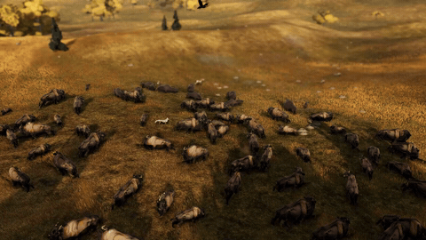
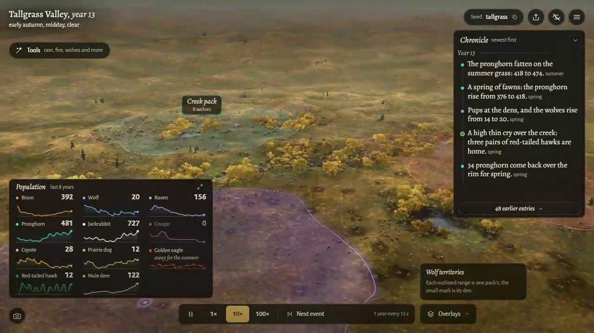

# Tallgrass


A living prairie in the browser: bison, pronghorn, wolves and ravens in a valley that finds its own balance.



**[Landing page](https://tallgrass.pages.dev)** · **[Play](https://tallgrass.stewartgregerson.workers.dev)**

## What it is

Tallgrass is an ecosystem you can leave running on a second monitor. Grass greens and cures with the seasons, bison and pronghorn graze and multiply, wolf packs hold territories and hunt, coyotes, cougars and ravens work the margins, and over the centuries the valley booms, crashes and recovers without ever settling into a flat line. Leave it alone and a documentary camera picks its own shots while a narrator calls out droughts, stampedes and new packs. Step in with rain, drought, fire, plague, a cull or a reintroduction and watch the change ripple up the food chain. Click any animal to follow its life: its pack, its heritable traits, its family tree and an In memoriam card when it dies. The balance is not tuned by eye: the same simulation runs headless across many worlds for 1,200 valley-years at a time, and every rule change has to pass those stability gates before it ships.

## Screenshots

| | |
|---|---|
|  |  |
|  |  |

## How it was made

- **Simulation first.** The ecosystem is a TypeScript simulation (`src/sim/`) that is deterministic from a seed and independent of the renderer. `npm run batch` plays many worlds headless far faster than real time and writes population charts and stability metrics; `npm test` checks a golden hash, so every new mechanism ships as a parameter that is off by default until it passes.
- **Three.js renderer.** Terrain, grass, weather, snow, fire and day and night are drawn in WebGL from the simulation state (`src/render/`). The animal meshes are authored models retargeted to a shared leg rig and baked by a Blender script (`tools/import_animal.py`); the cottonwoods grow from a port of ez-tree.
- **Blind review loop.** Every visual change is captured from inside the browser by script (Playwright, `tools/video.mjs`, `tools/capture.mjs`). A critic that sees only the stills and charts, and Gemini watching the video (`tools/gemini_video_review.py`), review each round; over thirty rounds are logged in `REVIEWS.md` with every issue triaged fix, defer or reject.
- **Generated sound.** Ambience, animal calls, music cues and the narrator's lines were generated with ElevenLabs (ledger in `ASSETS.md`) and mixed live by the game.
- Built in October 2026 by Claude Code agents over long unattended runs, directed by Stewart Gregerson. Design notes: `DESIGN.md`, `ECOLOGY.md`, `DECISIONS.md`.

## Run it locally

```
npm install
npm run dev
```

Then open http://localhost:5199/. Headless: `npm run sim` (one world) and `npm run batch` (the stability suite). The landing page lives in `site/`.

## Credits

| What | Who | Licence |
|---|---|---|
| Bison model | ["Bison - animal"](https://sketchfab.com/3d-models/bison-animal-4b8f112fffb84ce19dac2578b39e03b1) by Brian Trepanier | [CC BY 4.0](https://creativecommons.org/licenses/by/4.0/) |
| Wolf model | ["WOLF - Realistic 3D Model (DEMO FREE)"](https://sketchfab.com/3d-models/wolf-realistic-3d-model-demo-free-8840b859a566485c874a27b1731e1db8) by WildMesh 3D | [CC BY-NC 4.0](https://creativecommons.org/licenses/by-nc/4.0/) |
| Mule deer model | ["DEER - Realistic 3D Model (DEMO FREE)"](https://sketchfab.com/3d-models/deer-realistic-3d-model-demo-free-3997d669818c4e0d8c8bcafb0a1ae2ee) by WildMesh 3D (antlers replaced) | [CC BY-NC 4.0](https://creativecommons.org/licenses/by-nc/4.0/) |
| Pronghorn model | ["Pronghorn"](https://sketchfab.com/3d-models/pronghorn-a8cb6abfb49841ed97f8480a36c26b3b) by FennecFyre | [CC BY-NC 4.0](https://creativecommons.org/licenses/by-nc/4.0/) |
| Coyote model | ["coyote"](https://sketchfab.com/3d-models/coyote-e350e508749c45baab4df6fb6cba8cd9) by Raven-Woods | [CC BY 4.0](https://creativecommons.org/licenses/by/4.0/) |
| Cougar model | ["Puma Gray"](https://sketchfab.com/3d-models/puma-gray-90f0fd2c4ce24d05acce011256953ca5) by 1225659838@qq.com (as listed on Sketchfab) | [CC BY 4.0](https://creativecommons.org/licenses/by/4.0/) |
| Ground textures (withered grass, dry mud, grass path, mud, burned ground, snow) | [Poly Haven](https://polyhaven.com) | CC0 |
| Cottonwood branch generator (`src/render/eztree.ts`, a geometry-only port) | [ez-tree](https://github.com/dgreenheck/ez-tree) by Daniel Greenheck | MIT |
| Alegreya and Alegreya Sans fonts | Juan Pablo del Peral (Huerta Tipográfica) | SIL OFL 1.1 |
| three.js, Vite, Playwright | their authors | MIT, MIT, Apache-2.0 |
| Sound effects, music and narration | Generated with ElevenLabs for this project | |
| Concept art (`art/concept/`, `journey/`) | Generated with Google Gemini for art direction | |

The three CC BY-NC models (wolf, mule deer, pronghorn) restrict the game to non-commercial use as long as they ship. Full details and processing notes: [CREDITS.md](CREDITS.md).

## Licence

Code is MIT (see [LICENSE](LICENSE)). Third-party assets listed above keep their own licences.
